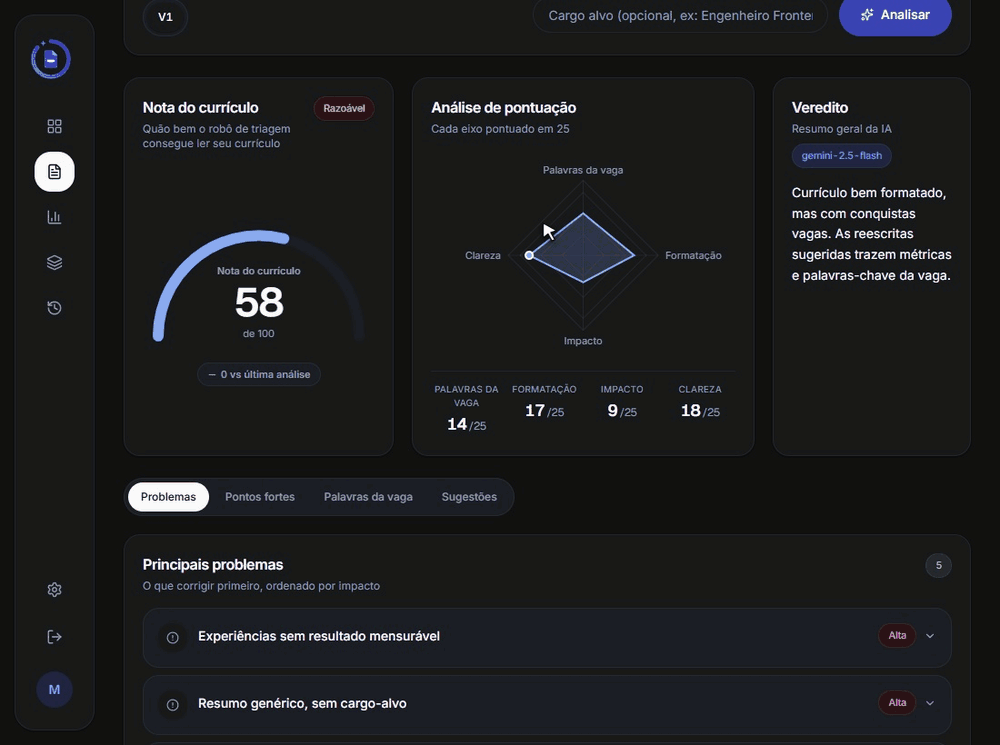
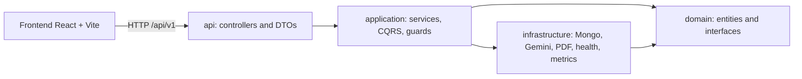
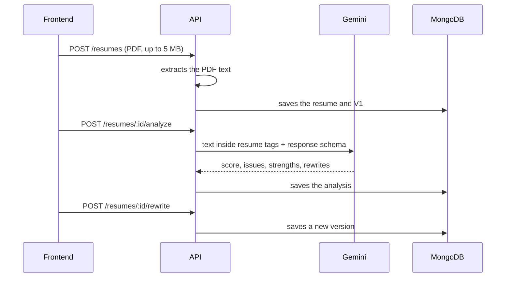

# Destrava Currículo

**English** | [Português](README.md)

[](https://github.com/LucasRossatto/ats-ai-resumer/actions/workflows/ci.yml)

**Shows whether your resume really got better between one version and the next.** You upload a PDF, the AI (Google Gemini) points out what is holding it back, you apply the suggested rewrites, create V2, and see what changed in the text and how much the score moved. Available in Brazilian Portuguese and English.

Who it is for: anyone tailoring a resume to job openings who wants to see, version by version, whether the evaluation improved.

**[Try the live demo](https://destrava-curriculo-demo.vercel.app)**

<p align="center">
  
</p>

## What sets it apart

There are plenty of AI resume analyzers. The focus here is on **evolution** and **trust in the score**:

- **Versioning with diff**: each resume has versions (V1, V2...) and the API compares the text of two versions (`GET /api/v1/resumes/:id/diff`).
- **Applying rewrites**: the bullet rewrites suggested by an analysis become a new version (`POST /api/v1/resumes/:id/rewrite`).
- **Score evolution**: the dashboard shows the series of scores across versions and the change since the first one.
- **A method to evaluate the score**: the score comes from an LLM, so the repository includes an eval (`pnpm eval`) that runs 10 fictional resumes through the same prompt and measures score stability (standard deviation across runs) and agreement with an expected label (weak, medium, strong). See [backend/docs/eval.md](backend/docs/eval.md) (in Portuguese); the actual numbers are still to be published.

The analysis returns a score with its breakdown, issues ranked by severity, strengths, keywords present and missing, and bullet rewrite suggestions.

## Demo

**Live demo: https://destrava-curriculo-demo.vercel.app**

The demo runs on free tiers, so it has two limitations:

- The server (Render) sleeps after 15 minutes without traffic. The first visit can take about 1 minute to respond.
- Analyses use the free Gemini quota, which is small and shared by all users. Late in the day a new analysis may be unavailable.

https://github.com/user-attachments/assets/bf5f8506-a158-49dd-84e1-e7fca551be7e

To run it on your machine, follow [Running in 5 minutes](#running-in-5-minutes).

## Architecture

A monorepo with two independent projects, `backend/` (NestJS) and `frontend/` (React + Vite), both using pnpm with no workspace at the root.

The backend follows Clean Architecture in four layers, with dependencies always pointing inward. An ESLint rule (`no-restricted-imports` per layer) fails the lint if `domain` imports another layer, or if `application` or `infrastructure` import `api`.



Main flow:



Details in [backend/README.en.md](backend/README.en.md) and [frontend/README.en.md](frontend/README.en.md).

## Stack

- Backend: NestJS 11, TypeScript, MongoDB (Mongoose), `@nestjs/cqrs`, Passport (JWT and Google OAuth), `@google/genai`, Swagger, Jest.
- Frontend: React 19, Vite, Tailwind 4, React Router 7, TanStack Query, Recharts, i18next (pt-BR and en), `@react-pdf/renderer`, Vitest.
- Infra: Docker Compose, Prometheus, Grafana.

## Running in 5 minutes

Prerequisites: Node 20+, pnpm, Docker, and a Gemini API key.

```bash
# backend
cd backend
cp .env.example .env     # fill in the required fields (table below)
pnpm install
pnpm docker:dev          # api, mongo, prometheus and grafana; API at http://localhost:4000

# frontend (another terminal)
cd frontend
pnpm install
pnpm dev                 # http://localhost:5173
```

Without Docker, run a local MongoDB, point `MONGODB_URI` to it, and use `pnpm start:dev` in the backend. In the backend `.env`, `MONGO_INITDB_ROOT_USERNAME`, `MONGO_INITDB_ROOT_PASSWORD` and `GRAFANA_PASSWORD` are required for the compose stack to start.

In development, the Vite proxy forwards `/api` to `http://localhost:4000`, so `VITE_API_URL` stays empty.

### Essential variables

The full list is in [backend/.env.example](backend/.env.example) and [frontend/.env.example](frontend/.env.example). The backend does not start without:

| Variable | Note |
| --- | --- |
| `JWT_SECRET`, `JWT_REFRESH_SECRET` | at least 32 characters (`openssl rand -hex 32`) |
| `GEMINI_API_KEY` | Gemini key |
| `EMAIL_ENCRYPTION_KEY` | email encryption key (exactly 64 hex characters) |
| `EMAIL_BLIND_INDEX_SECRET` | secret for the email blind index |

Relevant optional ones: `ANALYSIS_DAILY_LIMIT` (default 20), `CORS_ORIGINS`, `FRONTEND_URL`, `COOKIE_SAMESITE` (default `lax`), `COOKIE_DOMAIN`.

## Security

- **Session**: the refresh token travels in an `httpOnly` `refresh_token` cookie, with a path derived from `API_BASE_PATH` (`/api/v1/auth`). The access token lives only in memory on the frontend; no token is stored in `localStorage`.
- **Passwords** are hashed with bcrypt. **Refresh tokens** are stored as SHA-256, compared in constant time, and rotated on every use: replaying an old token returns 401. Email is encrypted at rest (AES-256-CBC, a 64-hex-character key validated at boot) with a blind index for lookups.
- **Google OAuth** uses an `oauth_state` cookie against CSRF; the backend redirects to `/auth/callback` on the frontend.
- **CORS** is restricted to `CORS_ORIGINS`, plus `helmet` and a `ValidationPipe` with `whitelist` and `forbidNonWhitelisted`.
- **Rate limiting** is 100 req/min globally, with lower limits on login, registration, upload, resume creation, rewrite and analysis (5 req/min on analysis).
- **Upload** accepts PDF only, up to 5 MB, checking the type and the `%PDF-` magic number.
- **AI cost control**: a per-user daily quota (`ANALYSIS_DAILY_LIMIT`, default 20, UTC calendar day). The resume text goes into the prompt between `<resume>` and `</resume>`, with an instruction to treat it as data only, and is truncated at 30,000 characters.
- **Docker**: multi-stage image, runs as the `node` user, `HEALTHCHECK`, pinned image tags. Mongo starts with authentication and, in production, with no published port (the port only exists in the dev override).

### Deploying with different domains

Because the refresh token is a cookie, a frontend and an API on different domains require `COOKIE_SAMESITE=none`, which only works over HTTPS (the cookie is sent with `Secure`). The recommended approach is subdomains of the same domain (for example `app.example.com` and `api.example.com`), with `COOKIE_DOMAIN=.example.com` and `COOKIE_SAMESITE=lax`. Also adjust `CORS_ORIGINS`, `FRONTEND_URL` and `VITE_API_URL`.

## Observability

- `GET /health` (Terminus) and `GET /metrics` (Prometheus), both outside the `/api` prefix.
- Prometheus on `:9090` and Grafana on `:3000` (ports and credentials in `.env`).
- One request id per request, present in the logs.
- Swagger at `/api/docs` only when `NODE_ENV` is not `production`.

## Quality

- Measured at this commit: backend with 30 suites and 340 passing tests, coverage of 75.7% statements, 59.1% branches, 65.5% functions and 74.5% lines (`pnpm test:cov`). Frontend with 14 files and 68 passing tests (`pnpm test`).
- CI in [.github/workflows/ci.yml](.github/workflows/ci.yml): the backend runs lint, tests and build; the frontend runs lint, typecheck, tests and build.
- **Score eval**: a script (`pnpm eval` in the backend, with `--dry-run`, `--runs N` and `--yes`) measures the stability of the LLM score over fictional resumes. **It has run against the real API, but only partially**: one run per resume, cut short by Gemini failures (503 and the free plan's daily quota of 20 requests). That is why the full result is not published yet, and [backend/docs/eval.md](backend/docs/eval.md) remains a report template. When there is a definitive failure, the script does not overwrite that file.

## Decisions and trade-offs

- **The score is an LLM's opinion, not a measurement from a real ATS.** No ATS is queried. Use the score to compare versions against each other, not as a guarantee of approval.
- The Gemini response is forced into a structured schema and validated afterwards, which reduces malformed responses but does not eliminate variation between runs (hence the eval).
- CQRS and sagas exist in the auth and profile flows; the rest uses plain application services. There is no Event Sourcing.
- An in-memory access token trades persistence for security: on page reload, the session is restored from the refresh cookie.
- TypeScript `strict` is currently off on the frontend.

## Limitations

- No OCR: only PDFs with selectable text work; scanned PDFs do not.
- Google login needs your own OAuth credentials (`GOOGLE_CLIENT_ID`, `GOOGLE_CLIENT_SECRET` and `GOOGLE_CALLBACK_URL`). Without them the API responds 503 on that route, and email and password login keeps working.
- The demo depends on free tiers (a server that sleeps and a small daily Gemini quota).
- No eval result published.

## Roadmap

- Run the eval against the real API and publish the numbers.
- OCR for scanned PDFs.
- A global daily limit on analyses in the demo, and a "server waking up" notice on the frontend.

## License

Backend under the [Unlicense](backend/LICENSE). Credit to the original template in [backend/README.md](backend/README.md).
