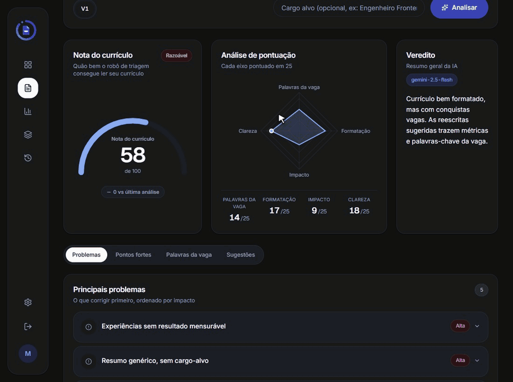
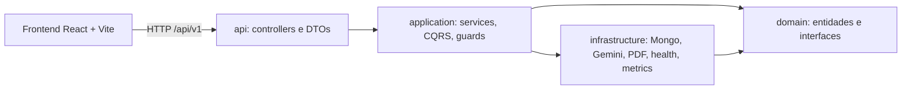
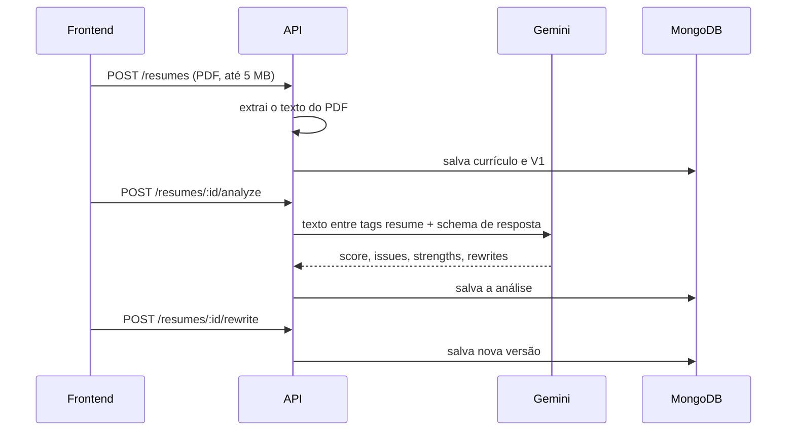

# Destrava Currículo

[English](README.en.md) | **Português**

[](https://github.com/LucasRossatto/ats-ai-resumer/actions/workflows/ci.yml)

**Mostra se o seu currículo melhorou de verdade entre uma versão e outra.** Você envia o PDF, a IA (Google Gemini) aponta o que está travando, você aplica as reescritas sugeridas, gera a V2 e vê o que mudou no texto e quanto a nota variou. Em português do Brasil e em inglês.

Para quem: quem ajusta o currículo para vagas e quer ver, versão a versão, se a avaliação melhorou.

**[Ver a demo online](https://destrava-curriculo-demo.vercel.app)**

<p align="center">
  
</p>

## O que o diferencia

Analisador de currículo com IA existe aos montes. Aqui o foco é a **evolução** e a **confiança no score**:

- **Versionamento com diff**: cada currículo tem versões (V1, V2...) e a API compara o texto de duas versões (`GET /api/v1/resumes/:id/diff`).
- **Aplicar reescritas**: as reescritas de bullets sugeridas em uma análise viram uma nova versão (`POST /api/v1/resumes/:id/rewrite`).
- **Evolução do score**: o dashboard mostra a série de scores das versões e a variação desde a primeira.
- **Score com método de avaliação**: o score vem de um LLM, então o repositório inclui um eval (`pnpm eval`) que roda 10 currículos fictícios pelo mesmo prompt e mede a estabilidade do score (desvio padrão entre execuções) e a coerência com um rótulo esperado (fraco, médio, forte). Veja [backend/docs/eval.md](backend/docs/eval.md); os números reais ainda serão publicados.

A análise devolve score com a composição, problemas apontados por severidade, pontos fortes, palavras-chave presentes e ausentes e sugestões de reescrita de bullets.

## Demo

**Demo online: https://destrava-curriculo-demo.vercel.app**

A demo roda em planos gratuitos, então tem duas limitações:

- O servidor (Render) dorme depois de 15 minutos sem uso. O primeiro acesso pode levar cerca de 1 minuto para responder.
- As análises usam a cota gratuita do Gemini, que é pequena e somada para todos os usuários. No fim do dia uma nova análise pode estar indisponível.

https://github.com/user-attachments/assets/bf5f8506-a158-49dd-84e1-e7fca551be7e

Para rodar na sua máquina, siga [Rodando em 5 minutos](#rodando-em-5-minutos).

## Arquitetura

Monorepo com dois projetos independentes, `backend/` (NestJS) e `frontend/` (React + Vite), ambos com pnpm e sem workspace na raiz.

O backend segue Clean Architecture em quatro camadas, com dependência sempre para dentro. Uma regra do ESLint (`no-restricted-imports` por camada) quebra o lint se `domain` importar outra camada, ou se `application` ou `infrastructure` importarem `api`.



Fluxo principal:



Detalhes em [backend/README.md](backend/README.md) e [frontend/README.md](frontend/README.md).

## Stack

- Backend: NestJS 11, TypeScript, MongoDB (Mongoose), `@nestjs/cqrs`, Passport (JWT e Google OAuth), `@google/genai`, Swagger, Jest.
- Frontend: React 19, Vite, Tailwind 4, React Router 7, TanStack Query, Recharts, i18next (pt-BR e en), `@react-pdf/renderer`, Vitest.
- Infra: Docker Compose, Prometheus, Grafana.

## Rodando em 5 minutos

Pré-requisitos: Node 20+, pnpm, Docker e uma chave da API do Gemini.

```bash
# backend
cd backend
cp .env.example .env     # preencha os campos obrigatórios (tabela abaixo)
pnpm install
pnpm docker:dev          # api, mongo, prometheus e grafana; API em http://localhost:4000

# frontend (outro terminal)
cd frontend
pnpm install
pnpm dev                 # http://localhost:5173
```

Sem Docker, rode um MongoDB local, aponte `MONGODB_URI` para ele e use `pnpm start:dev` no backend. No `.env` do backend, `MONGO_INITDB_ROOT_USERNAME`, `MONGO_INITDB_ROOT_PASSWORD` e `GRAFANA_PASSWORD` são obrigatórios para o compose subir.

Em desenvolvimento, o proxy do Vite encaminha `/api` para `http://localhost:4000`, então `VITE_API_URL` fica vazio.

### Variáveis essenciais

Lista completa em [backend/.env.example](backend/.env.example) e [frontend/.env.example](frontend/.env.example). O backend não sobe sem:

| Variável | Observação |
| --- | --- |
| `JWT_SECRET`, `JWT_REFRESH_SECRET` | mínimo de 32 caracteres (`openssl rand -hex 32`) |
| `GEMINI_API_KEY` | chave do Gemini |
| `EMAIL_ENCRYPTION_KEY` | chave de criptografia do e-mail |
| `EMAIL_BLIND_INDEX_SECRET` | segredo do blind index do e-mail |

Opcionais relevantes: `ANALYSIS_DAILY_LIMIT` (padrão 20), `CORS_ORIGINS`, `FRONTEND_URL`, `COOKIE_SAMESITE` (padrão `lax`), `COOKIE_DOMAIN`.

## Segurança implementada

- **Sessão**: o refresh token vai em cookie `refresh_token` `httpOnly`, com path derivado de `API_BASE_PATH` (`/api/v1/auth`). O access token fica só em memória no frontend; nenhum token é guardado em `localStorage`.
- **Senhas** com hash bcrypt. **Refresh tokens** guardados como SHA-256, comparados em tempo constante e rotacionados a cada uso: reapresentar um token antigo devolve 401. E-mail criptografado em repouso (AES-256-CBC, chave de 64 caracteres hexadecimais validada no boot) com blind index para busca.
- **Google OAuth** com cookie `oauth_state` contra CSRF; o backend redireciona para `/auth/callback` no frontend.
- **CORS** restrito a `CORS_ORIGINS`, `helmet` e `ValidationPipe` com `whitelist` e `forbidNonWhitelisted`.
- **Rate limit** global de 100 req/min e limites menores em login, registro, upload, criação de currículo, reescrita e análise (5 req/min na análise).
- **Upload** só PDF, até 5 MB, com checagem de tipo e do magic number `%PDF-`.
- **Custo da IA**: cota diária por usuário (`ANALYSIS_DAILY_LIMIT`, padrão 20, dia civil UTC). O texto do currículo vai ao prompt entre `<resume>` e `</resume>`, com instrução para tratá-lo só como dado, e é cortado em 30.000 caracteres.
- **Docker**: imagem multi-stage, execução com o usuário `node`, `HEALTHCHECK`, tags de imagem fixas. O Mongo sobe com autenticação e, em produção, sem porta publicada (a porta só existe no override de dev).

### Deploy com domínios diferentes

Como o refresh token é cookie, front e API em domínios distintos exigem `COOKIE_SAMESITE=none`, que só funciona com HTTPS (o cookie sai com `Secure`). O caminho recomendado é usar subdomínios do mesmo domínio (por exemplo `app.exemplo.com` e `api.exemplo.com`), com `COOKIE_DOMAIN=.exemplo.com` e `COOKIE_SAMESITE=lax`. Ajuste também `CORS_ORIGINS`, `FRONTEND_URL` e `VITE_API_URL`.

## Observabilidade

- `GET /health` (Terminus) e `GET /metrics` (Prometheus), ambos fora do prefixo `/api`.
- Prometheus em `:9090` e Grafana em `:3000` (portas e credenciais no `.env`).
- Request id (`x-request-id`) e log de cada requisição nas rotas de autenticação e perfil.
- Swagger em `/api/docs` só quando `NODE_ENV` não é `production`.

## Documentação técnica

Três documentos mapeiam o que o código faz de fato, incluindo as lacunas conhecidas:

- [Observabilidade](docs/observabilidade.md): logs, métricas, health check, request id, Prometheus e Grafana.
- [Segurança e OWASP Top 10](docs/owasp-top10.md): autoavaliação por categoria, com o arquivo que comprova cada controle.
- [Integração com o Gemini](docs/integracao-gemini.md): contrato de saída, prompt, resiliência, controle de custo e eval.

## Qualidade

- Medido neste commit: backend com 35 suítes e 380 testes passando, cobertura de 77,2% das statements, 66,6% dos branches, 68,5% das funções e 76,0% das linhas (`pnpm test:cov`). Frontend com 14 arquivos e 68 testes passando (`pnpm test`).
- CI/CD em [.github/workflows/ci.yml](.github/workflows/ci.yml): o backend roda audit de dependências, lint, testes e build; o frontend roda lint, typecheck, testes e build. Em push na `main`, o deploy no Render e na Vercel só começa depois que todas essas etapas passam.
- **Eval do score**: existe um script (`pnpm eval` no backend, com `--dry-run`, `--runs N` e `--yes`) que mede a estabilidade do score do LLM sobre currículos fictícios. **Já rodou com a API real, mas só parcialmente**: uma execução por currículo, interrompida por falhas do Gemini (503 e cota diária do plano gratuito, 20 requisições). Por isso o resultado completo ainda não está publicado, e [backend/docs/eval.md](backend/docs/eval.md) segue como modelo do relatório. Quando há falha definitiva, o script não sobrescreve esse arquivo.

## Decisões e trade-offs

- **O score é opinião do LLM, não uma medição de ATS real.** Nenhum ATS é consultado. Use o score para comparar versões entre si, não como garantia de aprovação.
- A resposta do Gemini é forçada a um schema estruturado e validada depois, o que reduz respostas malformadas mas não elimina a variação entre execuções (por isso o eval).
- CQRS e sagas existem nos fluxos de auth e profile; o resto usa services de aplicação diretos. Não há Event Sourcing.
- Access token só em memória troca persistência por segurança: ao recarregar a página, a sessão é restaurada pelo cookie de refresh.
- O `strict` do TypeScript no frontend está desligado por enquanto.

## Limitações

- Sem OCR: só PDF com texto selecionável, PDF escaneado não funciona.
- O login com Google exige credenciais OAuth próprias (`GOOGLE_CLIENT_ID`, `GOOGLE_CLIENT_SECRET` e `GOOGLE_CALLBACK_URL`). Sem elas a API responde 503 nessa rota, e o login por e-mail e senha continua funcionando.
- A demo depende de planos gratuitos (servidor que dorme e cota diária pequena do Gemini).
- Sem resultado de eval publicado.

## Roadmap

- Rodar o eval com a API real e publicar os números.
- OCR para PDFs escaneados.
- Limite diário global de análises na demo e aviso de "servidor acordando" no frontend.

## Licença

[Unlicense](LICENSE), domínio público. Crédito ao template de origem do backend em [backend/README.md](backend/README.md).
